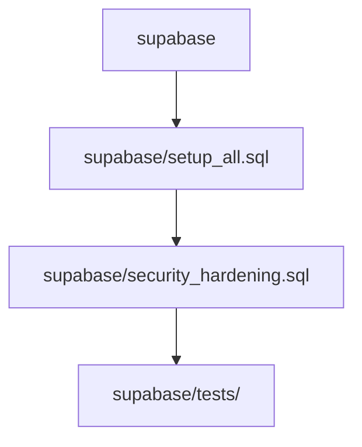

# 📚 smartbudget-DGOTIX Documentation

Welcome to the complete documentation for this repository. This documentation is automatically generated and maintained by Woden Docbot.

  

## 🔗 Quick Links

[📂 supabase](./supabase/README.md)

---

> A web-first (mobile-ready) personal finance app built with Flutter that tracks income, expenses, budgets, goals, debts, financial-health scoring, zakat and multi-currency with Arabic/English RTL support.

## 📖 Overview

smartbudget-DGOTIX is a Flutter-based personal finance application targeting web and mobile (Android) that implements income/expense tracking, budgets, savings goals, debts, financial-health scoring, zakat and multi-currency features with Arabic/English and RTL support. The repository contains both client-side app code (Dart/Flutter, Android/Gradle targets) and database provisioning assets.

The supabase/ directory holds the database-focused artifacts: a consolidated setup_all.sql to create the schema and initial objects, security_hardening.sql to apply runtime guards and access controls, and a tests/ subtree with automated validation suites to verify the Supabase-style schema and policies. Together the app code and the supabase scripts form the application and its DB provisioning, hardening, and verification surface.

### 🧩 Key Components

| Component | Purpose | Technologies |
| --- | --- | --- |
| **supabase** | Contains SQL schema, consolidated setup scripts, and security hardening measures for provisioning and protecting the SmartBudget database in a Supabase-compatible environment. | `SQL`, `Shell`, `Python` |
| **supabase/setup_all.sql** | Single-shot, consolidated database setup script intended to create the required schema and initial objects in the Supabase SQL editor. | `SQL` |
| **supabase/security_hardening.sql** | Applies security-hardening measures and runtime guards for the SmartBudget database to restrict and protect runtime behavior. | `SQL` |
| **supabase/tests/** | Automated validation suites and test harnesses that verify behavior of the Supabase-style schema and related access-control rules. | `Python`, `SQL` |

**Component Architecture:**

### 🏗️ Architecture

A Flutter (Dart) web-first/mobile app with an accompanying supabase/ directory that provisions, hardens, and tests the SQL database schema; Android/Gradle targets are present for mobile builds.

### 💡 Use Cases

- ✦ Track income and expenses
- ✦ Create and manage budgets
- ✦ Set and monitor financial goals
- ✦ Manage debts
- ✦ Handle multi-currency finances

### 🔧 Technologies

**Languages:**   

**Databases:** 
      

---

## 📑 Documentation Sections

### [supabase](./supabase/README.md)
Contains SQL schema, consolidated setup scripts, and security hardening measures for provisioning and protecting the SmartBudget database when deploying to a Supabase-compatible environment.

This directory holds the database-focused artifacts for the SmartBudget application intended to be run in a Supabase SQL environment.

---

## 📊 Documentation Statistics

- **Files Documented**: 3
- **Directories**: 3
- **Coverage**: 0%
- **Eligible Source Files**: 798
- **Last Updated**: 2026-11-19

---

## 🧭 How to Navigate

> ℹ️ **INFO**
> Each directory has its own README.md with detailed information about that section. Use the breadcrumb navigation at the top of each page to navigate back to parent directories.

### Navigation Features

- **Breadcrumbs** - At the top of each page, showing your current location
- **Directory READMEs** - Each folder has a comprehensive overview
- **File Documentation** - Click through to individual file documentation
- **Search** - Use GitHub's search or your IDE's search functionality

---

## 🤖 About Woden DocBot

This documentation is automatically generated and kept up-to-date by Woden DocBot, an AI-powered documentation assistant. DocBot analyzes code on every pull request and updates documentation to reflect changes.

### Features

- **Automatic Updates** - Documentation updates on every PR
- **Comprehensive Coverage** - Files, functions, classes, and directories
- **Smart Navigation** - Breadcrumbs, related files, and parent links
- **AI-Powered** - Uses Azure GPT models for intelligent documentation generation

---

*Generated by Woden DocBot for smartbudget-DGOTIX*